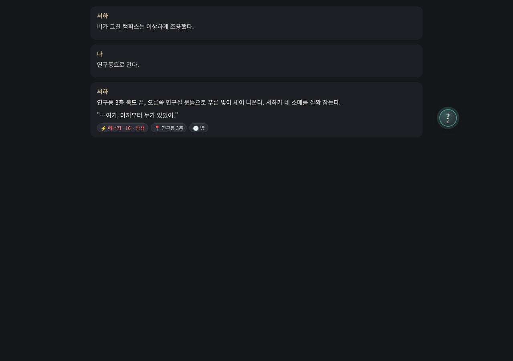
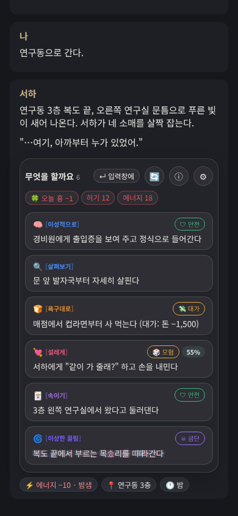

# 🎯 미트볼폰 선택지 (Meatball Phone Choices)

**AI 답 끝의 선택지를 누르기 쉬운 목록으로 바꾸고, 고르기 전에 대가 · 성공 확률을 보여 주는 실리태번 확장.**

```
https://github.com/dfzfs/meatballphone-choices
```
실리태번 › 확장(🧩) › 확장 설치 칸에 위 주소를 넣고 새로 고친다. [미트볼폰](https://github.com/dfzfs/meatballphone)과 같이 쓰면 지금 상태(장소 · 돈 · 욕구 · 운세)를 근거로 삼는다. 없어도 혼자 돈다. 미트볼폰 마켓 「기타 앱」 탭의 「설치」로 깔아도 된다.

| 노트북 (옆 동그라미) | 휴대폰 (목록) |
|---|---|
|  |  |

## 처음 쓰는 법
1. 깔고 새로 고친 뒤 아무 채팅이나 연다.
2. AI 답 밑의 「🎯 선택지 받기」를 누른다 (AI 1회).
3. 선택지를 눌러 설명 · 위험 · 성공 확률을 본다.
4. 「이걸로」를 누르면 입력창에 들어간다 (설정에서 「바로 보내기」로 바꿀 수 있음).
5. 🎲 모험을 고르면 그 자리에서 d20을 굴리고, 결과가 다음 본편 답에 반영된다.

## 끄는 법
| 무엇을 | 어떻게 | 그러면 |
|---|---|---|
| 전체 | 확장 설정 「미트볼폰 선택지」 › 사용 끔 (또는 확장 관리에서 끔) | 모든 채팅에서 쉼 |
| 이 채팅만 | 확장 설정 「이 채팅에서만 끄기」 또는 폰 🎯 앱 「이 채팅」 | 그 채팅엔 목록 · 칩 · 본편 지시 없음 |
| 채팅에 안 보이게 | 보기 › 📱 폰 안에서만 | 채팅에는 아무것도 안 붙고 폰 🎯 앱 안에서만 고름 |

## 지우는 법
- **확장 삭제**: 실리태번 › 확장 관리 › 「미트볼폰 선택지」 🗑. 미트볼폰 마켓에서 앱 「지우기」를 하면 폰 홈에서만 빠진다.
- **글에 흔적 안 남음**: 끄거나 지울 때 답 글에 남은 선택지 블록은 메시지의 숨은 칸(`extra`)으로 옮긴다. 지난 선택지는 어느 경로로도 AI에게 다시 가지 않는다.

## 토큰과 AI 호출
| 언제 | 추가 AI 호출 | 본편에 더해지는 글 |
|---|---|---|
| 평소 (기본 「눌러서」) | 0회 | 0 |
| 「🎯 선택지 받기」 · 🔄 다시 받기 | 누를 때마다 1회 (지금까지의 대화 + 요청 약 300토큰) | 0 |
| 🧭 진행 · 🔎 숨은 사실 · 🔮 스포 탭을 처음 누를 때 | 1회 (세 탭 한꺼번에) | 0 |
| 주사위 · 대가 · 함정 선택을 고른 다음 답 1번 | 0회 | 약 70~95토큰 |
| 받는 때를 「매 답」으로 바꾸면 | 0회 (본편이 같이 씀) | 답마다 약 330토큰 (미트볼폰 있으면 약 390) |

## 밖으로 나가는 요청
없다. AI 호출은 사용자가 고른 실리태번 연결로만 간다.

## 문제 생기면
미트볼폰이 있으면 「📋 전체 복사」(선택지 기록도 같이 담김), 없으면 F12 콘솔 내용을 [이슈](https://github.com/dfzfs/meatballphone-choices/issues)에 붙여 넣는다.

## 라이선스
MIT ([LICENSE](LICENSE)). 바뀐 것은 [CHANGELOG.md](CHANGELOG.md).

---

# 자세한 설명

## 하는 일
- 본편 답 끝의 `<choices>` 블록을 목록으로 보여 준다. 미트볼폰 칩(`.ml-msg`) 바로 위에 붙는다. **추가 AI 호출 0회** (🔄 다시 받기를 누를 때만 1회).
- 개수 3~6개 (기본 4). 선택지마다 **성향 1개 + 위험 1개**.
  - 성향 6종: 🧠 이성적으로 · 🎭 성격대로 · 🍞 욕구대로 · 😜 장난스럽게 · ⚔ 정면으로 · 🎲 운에 맡기기
  - 위험 4종: 보통 · 🛡 안전 · 🎲 모험(d20) · 💸 대가 — + 🪤 **함정**(기본 끔): 「안전」으로 위장, 이야기와 어긋난 데가 한 곳. 고르면 다음 답에 함정 발동, 지난 칩에서 「함정이었다」
- 눌러서 설명 · 확률을 보고 「이걸로」(설정에서 한 번 누르기로). 고르면 **원문(번역 전)** 이 입력창에 들어가거나 바로 보낸다.
- **모험**: 고르기 전에 성공 확률과 보정 내역, 고르는 순간 d20. 보정은 미트볼폰 `diceParts()` + 오늘 운세(🍀 +2 · ⚠ −2, 운에 맡기기는 두 배)만.
- **대가**: 선택지 글엔 안 쓰고 미트볼폰 `preview()` 배지(「−1,500원 · 허기 +40」)에만.
- 🔄 **선택지만 다시 받기**: 추가 지시를 붙여서. 바로 전 선택지만 피하게. 번역을 쓰는 채팅이면 번역도 같이 받아 화면엔 번역, 입력엔 원문.

## 탭: 🎯 선택지 · 🧭 진행 · 🔎 숨은 사실 · 🔮 스포
선택지와 **같은 자리**에 탭으로 있다. **고를 수 있는 건 선택지뿐**이고, 나머지 탭은 보여 주기만 한다.
- 🎯 **선택지**: 매 턴 답과 함께 온다.
- 🧭 **진행**: 이야기가 다음에 갈 만한 방향 2~3개
- 🔎 **숨은 사실**: 이야기에 쓸 만한데 아직 조명을 못 받은 작은 정보 3~5개 (예: 「레온의 주머니에는 그동안 찾던 이어폰이 들어 있다」 · 「이 산에는 귀신이 나온다는 소문이 있다」). 새로 만들어도 되지만 설정과 어긋나지 않게.
- 🔮 **스포**: 「이렇게 하면 → 이렇게 될 것」 2~3개

진행 · 숨은 사실 · 스포는 **처음 누를 때 AI 1회로 한꺼번에** 받고(설정에서 둘 탭 고르기), 🔄로 지금 탭만 다시(추가 지시 가능). 결과는 그 답 extra(스와이프마다)에 저장 → 다시 열어도 남고 **AI에게는 안 간다**. 평소 부하 0 · 누를 때 AI 1회(지금까지의 대화가 함께 들어가므로 답 하나 받는 정도 · 요청 글 약 300토큰).

## 보는 방식
- **목록**(기본): 답 밑, 미트볼폰 칩 바로 위
- **옆 동그라미**: 채팅 옆 빈자리에 「?」 하나 → 마우스를 올리면(휴대폰은 누르면) 지금 탭의 항목이 부채꼴로 펼쳐짐 · 탭은 동그라미 옆 단추 줄 · 다시 누르면 닫힘 · 위가 좁으면 단추 줄을 아래로 · 좁은 화면(700px 아래)은 목록

## 미트볼폰이 있으면 지금 상태를 근거로
장소 · 같이 있는 사람 · 급한 욕구 · 오늘 운세를 한 줄(약 56토큰)로 넘긴다. 미트볼폰이 `scene()`을 열면 그 장소에서 살 수 있는 것 · 인물이 원하는 것도 같이. 넘기는 글의 토큰 수는 ⚙ 설정에 보인다.

## 지난 선택지
- 내가 보내면 **그 전 모든 답**의 `<choices>`를 본문(`mes` · 모든 스와이프 · 번역 글)에서 빼서 그 메시지 extra(스와이프마다)로 옮긴다.
- 화면엔 **고른 것 하나만** 칩으로 남는다(성향 · 주사위 결과 · 대가). 누르면 그때 선택지 전체를 읽기 전용으로. 직접 쓴 답이면 칩도 없다.
- **어떤 경로로도 AI에게 안 간다**: 본문에서 빠져 있고, 채팅 완성 · 글 완성 프롬프트에서도 한 번 더 뺀다. 고른 기록(extra)도 안 들어간다.
- 결과 지시(주사위 성공 · 실패, 대가)는 **고른 바로 다음 답 1번에만**. 재생성하면 같은 지시를 다시 쓰고, 다음에 보내면 새로 계산한다.

## 분기 · 되돌리기
저장은 「선택지 = 그 AI 메시지 extra(스와이프마다)」 · 「고른 기록 = 그다음 사용자 메시지 extra」뿐이라 저절로 맞는다.
- **분기**: 그 답의 선택지가 다시 고를 수 있게 뜬다. 지난 칩의 「↪ 여기서 다른 선택」은 실리태번 기본 분기로 그 답에서 새 분기를 만든다.
- **메시지 삭제**: 뒤를 지우면 그 답의 선택지가 다시 산다.
- **스와이프**: 옛 스와이프로 넘기면 그 스와이프의 선택지.

## 미트볼폰 A · B 모드
미트볼폰 통로의 `mode()`로 읽는다(없으면 A).
- **A 모드** (본편 AI가 `<meatball>` 사건 줄을 씀): 결과 지시에 「결과를 `<meatball>` 사건 줄로 적어라」를 붙인다.
- **B 모드** (본편은 소설만 · 답이 끝나면 분류 모델이 사건을 고름): 결과 지시에서 `<meatball>` 부분을 빼고 「결과를 이야기로 분명히 보여 줘라」만 남긴다. 선택지 안내에서도 `<meatball>`을 말하지 않는다. 결과는 아래 **고른 기록 `mbc`** 를 미트볼폰 분류 모델이 읽어서 사건으로 고른다.
- 미트볼폰에 `pendingChoice(기록)`이 있으면 보낼 때 거기에도 넘긴다(`mesId` = 그 사용자 메시지 번호 추가). `mbc`는 어느 모드든 늘 남긴다(칩 · 분기에 씀).

### 고른 기록 `mbc` (사용자 메시지 `extra.mbc` · 미트볼폰이 읽는 약속)
| 필드 | 뜻 |
|---|---|
| `v` | 기록 형식 판 (지금 `1`) |
| `n` | 고른 선택지 번호 (그 답의 선택지 중 0부터) |
| `kind` | 성향 id: `rational` 이성적으로 · `persona` 성격대로 · `need` 욕구대로 · `tease` 장난스럽게 · `brave` 정면으로 · `fate` 운에 맡기기 |
| `risk` | 위험 id: `none` 보통 · `safe` 안전 · `gamble` 모험 · `price` 대가 · `trap` 함정 |
| `label` | 입력창에 넣은 글 (원문 · 설정이 「화면 글」이면 화면 글) |
| `shown` | 화면에 보인 글 (번역이면 번역) |
| `check` | 주사위 (모험 · 운에 맡기기만, 아니면 `null`): `roll` d20 눈 · `mod` 보정 합 · `parts` 보정 내역 `[[이유, 값]]` · `dc` 난이도 · `dcName` · `pct` 고르기 전 성공 확률(%) · `ok` 성공 여부 · `crit` 20 · `fumble` 1 |
| `outcome` | 주사위 결과: `success` · `fail` · `crit` · `fumble` · 주사위 없으면 `null` |
| `trap` | 함정을 골랐으면 `true` (다음 답에서 함정 발동) |
| `price` | 대가를 골랐으면 `true` (얻는 것과 함께 대가를 치름) |

## 채팅 저장 (윈도우 EPERM 막기)
윈도우 실리태번은 저장이 겹치면 `EPERM: rename … .jsonl`로 실패한다. 그래서 저장은 `src/core.js`의 한 군데에서만 한다.
1. **답을 받는 중엔 절대 저장하지 않는다.** `GENERATION_STARTED`부터 `GENERATION_ENDED` · `MESSAGE_RECEIVED`까지는 할 일만 모아 둔다.
2. `saveChat()` · `saveMetadata()`를 직접 부르지 않고 **`saveChatDebounced()`만** 쓴다(chatMetadata도 채팅과 함께 저장됨).
3. 답이 끝나면 **1초 뒤**(실리태번 자체 저장이 끝난 뒤) **한 번만** 저장한다. 그 사이 다시 끝남 신호가 와도 한 번으로 모인다.
4. 본문(`mes`)을 고치는 일(지난 선택지 블록 떼기)도 **답을 다 받은 뒤 그 1초에 한 번에** 한다. 이번 프롬프트에서는 보내는 글에서 빼 주므로 새지 않는다.
5. 답을 받는 중엔 🔄 다시 받기 · 탭 받기를 막는다(끝난 뒤에 다시).

## 디자인
미트볼폰 CSS 변수(`--ml-accent` · `--ml-font` · `--ml-size` · `--ml-radius` · `--ml-border` · `--ml-shadow`)를 그대로 쓴다. 미트볼폰이 없으면 실리태번 기본 색.

## 설정 (⚙ — 채팅 옆에 뜨는 판)
사용 · 개수 · 고르는 법(두 번/한 번) · 고르면(입력창에/바로 보내기) · 넣을 글(원문/화면 글) · 보는 방식(목록/옆 동그라미) · 둘 탭(진행 · 숨은 사실 · 스포) · 성향 6개 켜고 끄기 · 위험 5개 켜고 끄기(함정은 기본 끔) · 주입 깊이 · 넘기는 글 보기(토큰 수). 옛 판 설정은 처음 켤 때 한 번 정리된다(남는 것만 옮기고 나머지 키는 지움).

## 부하 (가짜 실리태번 · 메시지 601개)
| | v0.3.6 | v0.4.0 |
|---|---|---|
| 매 턴 주입 | 약 580토큰 | 약 330토큰 (미트볼폰 있으면 약 390 · 장면 줄 포함) |
| 고른 다음 1번만 결과 지시 | +약 120 | +약 70~95 |
| 마지막 선택지 다시 확인 | 0.23ms | 0.03ms |
| 마지막 선택지 새로 그리기 | 1.7ms | 0.08ms |
| 채팅 열 때 전체 | 30ms | 12ms |

## 시험
`node tools/harness/test.mjs` (playwright · `PW=` · `CHROME=`로 경로 지정 가능). 가짜 실리태번(`tools/harness/stub.js`)이 스와이프 · 분기 · 삭제 · 재생성 · 이어쓰기를 실리태번처럼 흉내 낸다.
- 10턴 동안 매 턴 고르고 보내기 → 보낸 프롬프트에 선택지 블록 0 · 안 고른 선택지 글 0 · 결과 지시는 주사위 · 대가가 있을 때만 바로 다음 1번 · 고른 기록 0
- 직접 쓴 답 · 재생성 · 빈 입력 · 이어쓰기 · 다시 열기 · 칩 펼치기 · 분기 · 삭제 · 스와이프(새 · 옛 · 보관된) · 다시 받기
- 미트볼폰 없음(채팅 완성) · 미트볼폰 있음(채팅 완성 · 글 완성) · 휴대폰 폭
- 함정(기본 끔 · 위장 · 발동 · 칩 공개) · 옆 동그라미(펼침 · 고르기 · 좁은 화면은 목록) · 탭(누르기 전 0회 · 처음 누르면 1회로 세 칸 · 선택지 자리에 · extra에만 · 보여 주기만 · 🔄 이 탭만 + 추가 지시 · 다음 프롬프트에 안 감 · 새 답이면 선택지 탭부터 · 옆 동그라미에서도)
- B 모드(미트볼폰 `mode()` = B): 10턴 정리 시험 한 번 더 · 결과 지시와 선택지 안내에 `<meatball>` 없음 · `mbc` 필드 빠짐없이 · `pendingChoice()`에도 넘김
- 저장(미트볼폰 없음 · 있음): 6턴(고르기 · 직접 쓰기) + 재생성 + 이어쓰기 + 다시 받기 + 탭 받기 → 받는 중 저장 0회 · `saveChat` 직접 0회 · `saveMetadata` 0회 · 답(동작) 하나에 저장 요청 1번 이하 · 답이 끝나고 1초 뒤 · 받는 중엔 앞 답 본문을 안 고치고 끝난 뒤 블록이 빠짐
- 현재: 통과 483 · 실패 0

